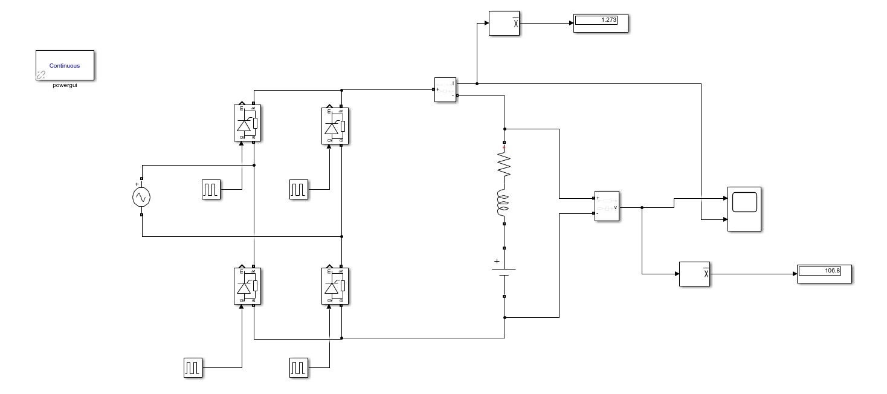
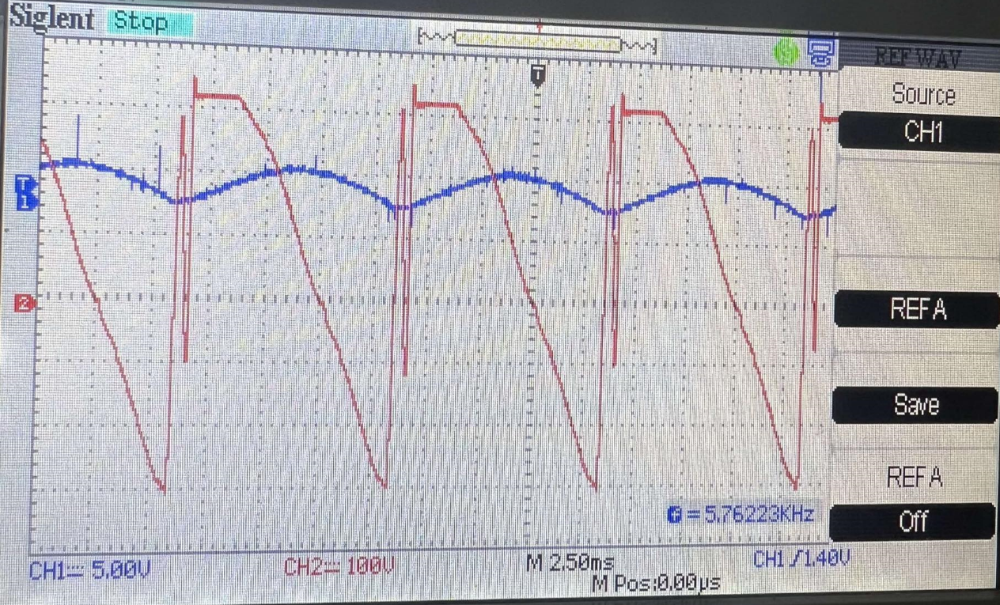

# Thyristor Rectifier and DC Motor

Practical implementation and experimental validation of a thyristor bridge supplying a DC machine, supported by MATLAB calculations and simulation diagrams.

## Practical implementation and experimental validation

- Implemented and studied the rectifier/DC-machine arrangement in the laboratory.
- Recorded output voltage and current waveforms while varying the firing angle.
- Analysed average rectified voltage, current and motor speed versus firing angle.
- Compared operation with a freewheeling diode and with an additional smoothing inductor.
- Compared experimental observations with the theoretical and simulation results documented in the French report.

The practical measurements and simulation outputs are identified separately in the French report. The image below is a simulation diagram, not a photograph of the physical setup.

### Experimental waveform capture

Recorded waveforms from the practical implementation (see the French report for the operating conditions).

## Repository contents

| File | Purpose |
| --- | --- |
| [thyristor-dc-motor-report-fr.pdf](thyristor-dc-motor-report-fr.pdf) | Full French report: experimental setup, measurements, calculations and simulation comparisons. |
| [results-and-waveforms.zip](results-and-waveforms.zip) | Complete archive of the supplied diagrams, waveforms and spectra. |
| [simulation-diagram.png](simulation-diagram.png) | Simulation diagram preview shown below. |
| [conduction-angle.m](conduction-angle.m) | MATLAB analysis script. |
| [freewheeling-diode-analysis.m](freewheeling-diode-analysis.m) | MATLAB analysis script. |
| [rectifier-characteristics.m](rectifier-characteristics.m) | MATLAB analysis script. |
| [average-voltage-analysis.m](average-voltage-analysis.m) | MATLAB analysis script. |

## Getting started

1. Read the French report to understand the circuit, operating conditions and measurement protocol.
2. Extract `results-and-waveforms.zip` to inspect the recorded results and simulation figures.
3. Run the MATLAB analysis scripts individually and use the circuit diagrams in the report for the simulation study.
The supplied files for this project contain MATLAB scripts and simulation figures; an editable Simulink model was not included.

## Software requirements

MATLAB is required for `.m` scripts. Simulink and the power-system blocks used by the model are required for `.slx` files. Some analytical scripts use `syms`/`vpasolve` and therefore require Symbolic Math Toolbox. The exact original MATLAB release is not specified; model compatibility should be checked in your installation.

## Project context

Academic power-electronics project completed at the National Polytechnic School of Algiers in 2024/2025, including practical laboratory work and simulation. This repository presents Amani Mouaad’s portfolio version of a collaborative academic project.

**Portfolio author:** Amani Mouaad  
**Supervision:** Pr. M. Mahmoudi and Mr. Benachour.

The technical report is retained in French. Repository documentation is in English. The original source documents are preserved separately.

## Reproducibility

The supplied models and scripts are preserved for inspection and reproduction. They have not been rerun in MATLAB/Simulink during repository preparation; published experimental observations come from the supplied report and results.
