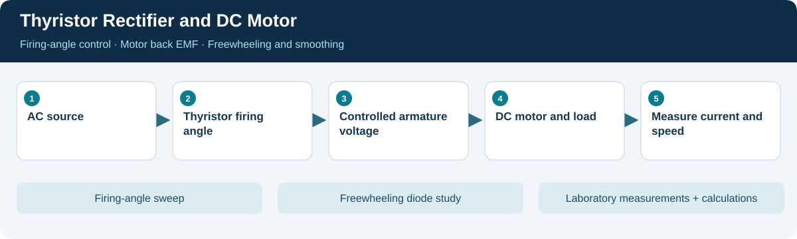
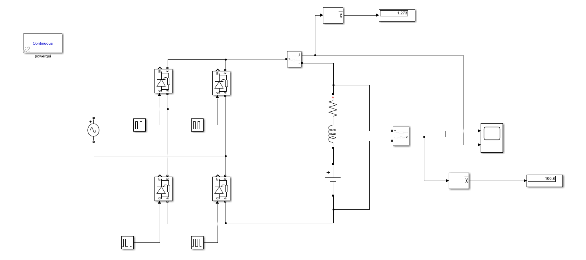
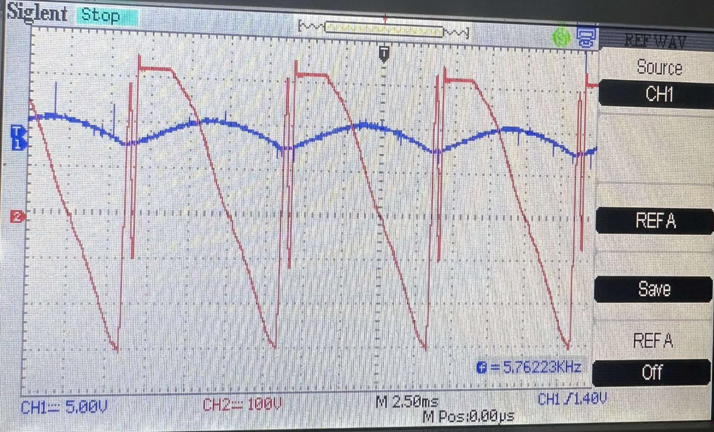

# Thyristor Rectifier and DC Motor

**Firing-angle control · Motor back EMF · Freewheeling and smoothing**

A laboratory and MATLAB study of a controlled rectifier supplying a DC machine. The project connects firing-angle changes to rectified voltage, conduction intervals, armature current and motor speed, with additional freewheeling and smoothing studies.

Power-electronics group project at the National Polytechnic School of Algiers, 2024/2025.  
**Author:** Amani Mouaad · **Supervision:** Pr. M. Mahmoudi and Mr. Benachour.

## Control through the conduction interval

The thyristor firing angle changes when conduction begins within each supply cycle. The load includes a motor back EMF, resistance and inductance, so current flow depends on both the supply waveform and the machine’s operating state. The conduction interval determines the average voltage delivered to the armature.

| Study | Engineering question |
|---|---|
| Firing-angle sweep | How do mean voltage and motor speed change with the command? |
| Conduction interval | When does armature current begin and cease? |
| Freewheeling diode | How does an alternate current path change the waveform? |
| Additional inductance | How does smoothing change current variation and conduction? |

## Circuit and waveforms

The [French report](thyristor-dc-motor-report-fr.pdf) documents the circuit variants, settings and measurement conditions.

## Link between voltage, current and speed

The armature balance can be expressed as:

$$v_a=R_ai_a+L_a\frac{di_a}{dt}+K_e\omega$$

The electromagnetic torque follows the armature current for a fixed field:

$$T_e=K_ti_a$$

Changing the firing angle changes the applied-voltage waveform and therefore its mean value:

$$\langle v_a\rangle=\frac1T\int_0^T v_a(t)\,dt$$

This connects the rectifier command to the motor’s electrical and mechanical response. The scripts account for conduction intervals and back EMF in the documented analytical cases.

## Recorded voltage points

`average-voltage-analysis.m` uses a 127 V RMS supply parameter and includes these experimental voltage points:

| Firing angle | Recorded mean voltage |
|---|---:|
| 48.6° | 145 V |
| 57.6° | 120 V |
| 70.2° | 95 V |
| 91.8° | 60 V |
| 108° | 35 V |
| 126° | 0 V |

The script plots the recorded data and the analytical expression for its chosen conduction case. These values describe that case in the report rather than a universal rectifier characteristic.

## Why include a freewheel and smoothing study

Motor inductance stores energy, so current need not stop when the source-voltage interval ends. A freewheeling path changes where that current flows. An additional inductor changes how quickly it varies. Comparing these cases explains the current waveform rather than considering average voltage alone.

## Explore the project

1. Read [thyristor-dc-motor-report-fr.pdf](thyristor-dc-motor-report-fr.pdf) for the experimental setup.
2. Inspect `average-voltage-analysis.m` for the mean-voltage comparison.
3. Use `conduction-angle.m` and `rectifier-characteristics.m` for the analytical conduction studies.
4. Inspect `freewheeling-diode-analysis.m` for the freewheel case.
5. Extract [results-and-waveforms.zip](results-and-waveforms.zip) for the complete diagrams and traces.

## Files and tools

| File | Role |
|---|---|
| `average-voltage-analysis.m` | Mean voltage and recorded measurement comparison |
| `conduction-angle.m` | Conduction-interval calculation |
| `rectifier-characteristics.m` | Voltage/conduction study |
| `freewheeling-diode-analysis.m` | Alternate current-path analysis |
| [Report](thyristor-dc-motor-report-fr.pdf) | Practical work and calculations |

**Tools:** MATLAB and Symbolic Math Toolbox for the symbolic calculations.

## Related projects

[Three-Phase Diode Rectification](https://github.com/MouaadO/three-phase-diode-rectifier) · [Jones Thyristor Chopper](https://github.com/MouaadO/jones-thyristor-chopper)
